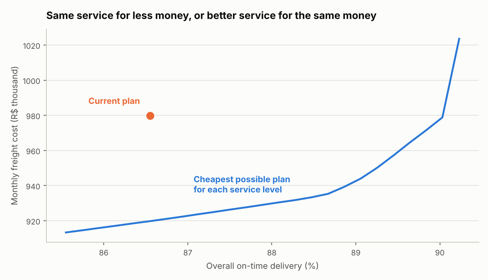
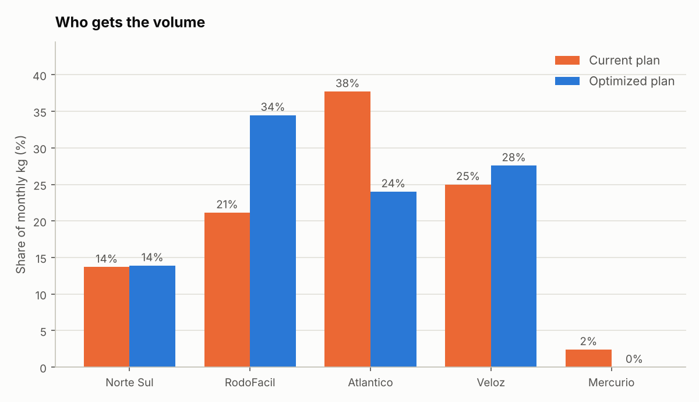

# Otimizador de Alocação de Transportadoras

Decide **quantos kg cada transportadora deve levar em cada rota** para a conta mensal de frete ser a menor possível, sem piorar a entrega no prazo e respeitando limites do negócio (capacidade, compromissos, concentração).
Usa programação linear (SciPy / HiGHS) e programação inteira mista para regras de "lote mínimo".

> Todos os dados são **fictícios**: 8 rotas saindo de Campinas, 5 transportadoras, 725.000 kg por mês.

🇬🇧 English version: [README.md](README.md)

## A pergunta, em palavras simples

Hoje o volume é dividido por hábito. Se eu tratar essa divisão como uma decisão, qual é o jeito mais barato de enviar a mesma carga com o mesmo serviço (ou melhor)? E quanto custa cada ponto a mais de entrega no prazo?

## Resultados nos dados fictícios

| | Custo / mês | No prazo |
|---|---|---|
| Plano atual | R$ 979.803 | 86,6% |
| **A.** Mesmo serviço, otimizado | **R$ 919.816 (-6,1%)** | 86,6% |
| **B.** Mesmo orçamento, melhor serviço | R$ 979.803 | **90,1%** |
| Máximo de pontualidade possível | | 90,2% |

- **A** economiza cerca de R$ 60 mil por mês (R$ 720 mil por ano) mantendo o serviço de hoje.
- **B** gasta exatamente o que se gasta hoje e compra +3,5 pontos percentuais de pontualidade.
- **Preço-sombra:** no nível de serviço de hoje, cada ponto percentual a mais custa cerca de **R$ 6.469 por mês**. Perto do teto isso dispara: os últimos 0,2 ponto custam cerca de R$ 45 mil (veja o gráfico).




### Análises "e se" (completas em `output/report.md`)

- **Choque de preço (+8% em uma transportadora):** se a RodoFacil subir 8%, manter o plano custa R$ 12.475 a mais por mês do que reotimizar. Uma transportadora que o plano não usa (Mercurio) não muda nada.
- **Custo das regras de negócio:** proibir qualquer transportadora de passar de 70% de uma rota custa +R$ 8.598/mês (+0,9%). Lote mínimo de 10.000 kg por transportadora/rota custa +R$ 2.709/mês (+0,3%). Regra tem preço, e agora ele aparece.

## O modelo

- **Variáveis:** `x[rota, transportadora]` = kg (só nas rotas que ela atende).
- **Minimizar:** soma de preço por kg × kg.
- **Restrições:** demanda de cada rota totalmente enviada; capacidade; participação mínima/máxima; pontualidade geral ≥ meta; pontualidade ≥ 80% em cada região; teto opcional por rota; lote mínimo opcional (variáveis binárias).
- Detalhes no docstring de `allocator/model.py`.

## Por que dá para confiar nos números

- `check()` é um **validador independente**: recalcula cada restrição a partir da tabela simples, sem as matrizes do otimizador. Os testes rodam em todo plano.
- O preço-sombra é **conferido por diferença finita** em um teste (resolve de novo com +0,05 ponto e compara).
- Um exemplo resolvido à mão (duas transportadoras, resposta R$ 150, preço-sombra R$ 2,5) é um teste.
- Pedido impossível devolve "infeasible" em vez de um plano errado.

## Como rodar

```bash
pip install -r requirements.txt
python scripts/generate_data.py
python scripts/run_optimization.py
pytest                                    # 10 testes
```

Opções: `--region-floor 0.78 --lane-cap 0.7 --min-lot 10000`.
Para usar seus dados, troque os CSV em `data/` (`lanes`, `carriers`, `offers`, `baseline`) mantendo os nomes das colunas.

## Limites (leia antes de usar com dados reais)

- **A pontualidade por transportadora e rota é tratada como fixa.** Na vida real, dar mais volume a uma transportadora pode piorar o desempenho dela. O modelo não sabe disso.
- Um mês, estático; preço linear no kg (sem faixas de volume).
- Capacidade e limites de participação são entradas em que você precisa confiar.
- Os números acima vêm de dados fictícios criados para esta demonstração.
